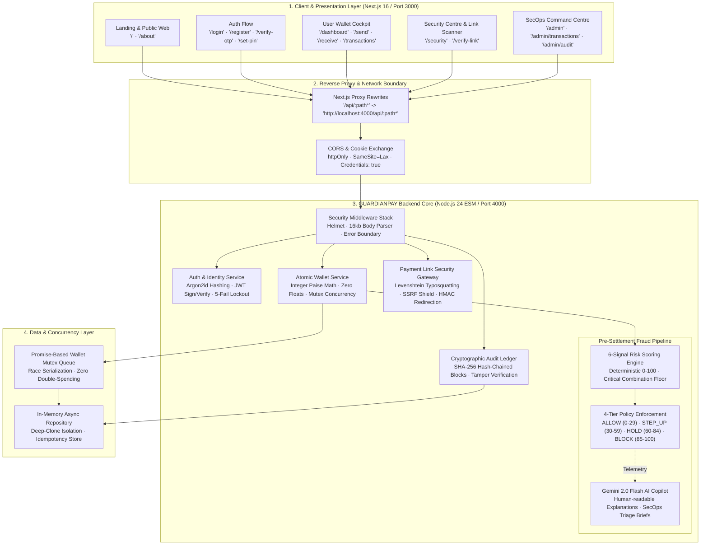
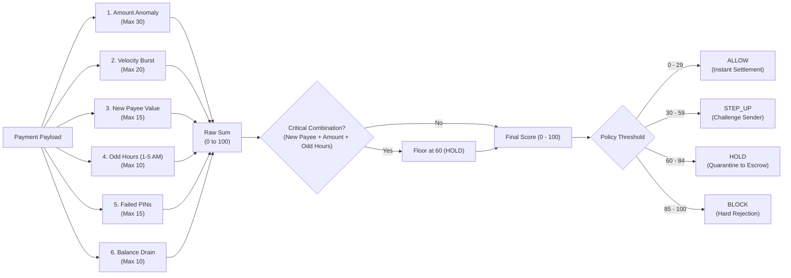
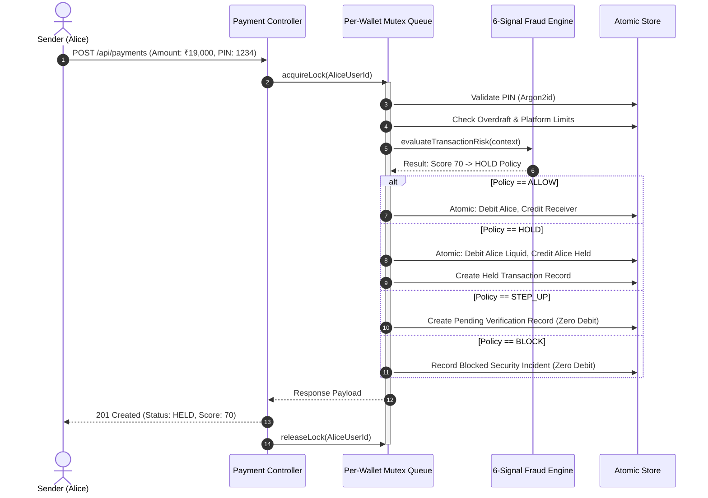
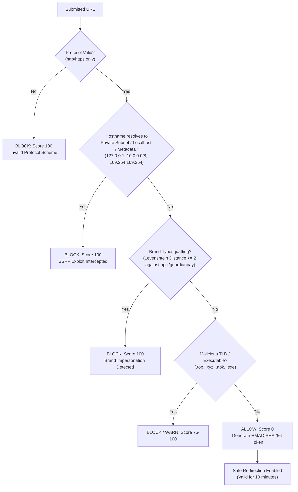

# GUARDIANPAY — Full System Architecture & Engineering Blueprint

> **System:** GUARDIANPAY (Intelligent Digital Wallet with AI Fraud Protection)  
> **Release Candidate:** 1.0.0 (HackMatrix 2026 Finals)  
> **Target Runtimes:** Frontend: Next.js 16.4.6 (Port 3000) | Backend: Node.js 24.12.0 ESM (Port 4000)  
> **Author:** Hackathon Architecture & Security Engineering Team

---

## 1. High-Level System Architecture Diagram



---

## 2. Component Architecture Breakdown

### 2.1 Client & Presentation Layer (Frontend)
- **Framework**: Next.js 16.4.6 App Router, React 19, TypeScript 5.
- **Styling Architecture**: Tailwind CSS v4, Framer Motion for hardware-accelerated transitions, Lucide React icons.
- **Brand Palette**:
  - `Black Pearl` (`#1A2C30`): Primary dark background and structural card fill.
  - `Blue Lagoon` (`#0E6873`): Primary brand teal, accents, and horizon glow.
  - `Burnt Orange` (`#FE7E3C`): Attention accents, active cursor spotlights, and high-priority action buttons.
  - `Lust` (`#E4201B`): Critical fraud indicators, block badges, and security alerts.
  - `Copper` (`#61413C`): Subtle metallic borders and card dividers.
  - `Emerald` (`#10B981`): Verified settlement confirmations and integrity pass indicators.
- **State Management & Communication**: Native React Hooks with centralized `src/lib/api.ts` client wrapper enforcing credentials exchange and typed error extraction.

### 2.2 Network & Security Middleware Stack
- **Helmet.js**: Sets security headers (`X-Content-Type-Options: nosniff`, `X-Frame-Options: SAMEORIGIN`, `Strict-Transport-Security`).
- **Body Parser Limits**: Strict 16kb payload ceiling (`express.json({ limit: '16kb' })`) guarding against payload memory exhaustion and denial-of-service.
- **CORS Configuration**: Restricts origin to `http://localhost:3000` with `credentials: true`.
- **Next.js Reverse Proxy**: Rewrites all `/api/*` requests internally to port 4000, eliminating browser cross-origin preflight overhead in production deployments.

### 2.3 Authentication & Session Subsystem
- **Password & PIN Hashing**: Uses **Argon2id** (`argon2.hash(val, { type: argon2.argon2id, memoryCost: 19456, timeCost: 2, parallelism: 1 })`).
- **JWT Cookies**: Issues signed JSON Web Tokens inside `httpOnly`, `SameSite=Lax` cookies with 24-hour expiration.
- **Sliding Lockout Engine**: Tracks failed PIN attempts in an in-memory sliding window. After 5 consecutive failures within 15 minutes, authentication is locked for 15 minutes (`PIN_LOCKED`).

---

## 3. The Pre-Settlement Fraud Pipeline

### 3.1 Six-Signal Algorithmic Architecture



### 3.2 Signal Computation Details

1. **Amount Anomaly ($S_1$)**:
   $$\bar{A} = \frac{1}{\min(N, 10)} \sum_{k=1}^{\min(N, 10)} A_k$$
   - $\text{Ratio} = \frac{\text{CurrentAmount}}{\bar{A}}$
   - $\text{Ratio} \ge 5.0 \implies 30\text{ pts}$
   - $\text{Ratio} \ge 3.0 \implies 20\text{ pts}$
   - For profiles with $<3$ baseline transactions: $\text{CurrentAmount} \ge ₹10,000 \implies 15\text{ pts}$.

2. **Velocity ($S_2$)**:
   Counts outgoing transactions in $[T - 5\text{ min}, T]$. If $\text{count} \ge 5 \implies 20\text{ pts}$.

3. **New Payee ($S_3$)**:
   Checks whether receiver UPI ID exists in trailing 50 successful transactions.
   - First-time recipient with amount $\ge ₹5,000 \implies 15\text{ pts}$.
   - First-time recipient with amount $< ₹5,000 \implies 5\text{ pts}$.

4. **Odd Hours ($S_4$)**:
   Local time $\in [01:00, 05:00] \implies 10\text{ pts}$.

5. **Failed PIN Attempts ($S_5$)**:
   Failures in past 15 min: $\ge 3 \implies 15\text{ pts}$; $\ge 1 \implies 5\text{ pts}$.

6. **Balance Drain ($S_6$)**:
   $$\text{DrainRatio} = \frac{\text{Amount}}{\text{Balance}}$$
   - $\text{DrainRatio} \ge 0.85 \implies 10\text{ pts}$.
   - $\text{DrainRatio} \ge 0.50 \implies 5\text{ pts}$.

---

## 4. Atomic Payment Settlement & Concurrency Model

### 4.1 Strict Financial Invariants
- **Zero Floats**: Stored strictly in integer paise ($1\text{ INR} = 100\text{ paise}$).
- **Conservation of Money**: In any successful transfer:
  $$\Delta \text{SenderBalance} + \Delta \text{ReceiverBalance} = 0$$
- **Quarantined Escrow (`HOLD`)**:
  $$\text{SenderBalance}_{\text{new}} = \text{SenderBalance}_{\text{old}} - \text{Amount}$$
  $$\text{SenderHeld}_{\text{new}} = \text{SenderHeld}_{\text{old}} + \text{Amount}$$
  $$\text{ReceiverBalance}_{\text{new}} = \text{ReceiverBalance}_{\text{old}} \quad (\text{Zero credit})$$

### 4.2 Mutex Serialization Sequence



---

## 5. Payment Link Security Gateway & SSRF Defense

### 5.1 Verification Logic Flow



---

## 6. Cryptographic SHA-256 Audit Ledger

### 6.1 Block Chaining Specification

Each audit block $B_n$ has the schema:

$$\text{CanonicalString}_n = \text{Seq}_n \parallel B_{n-1}.\text{hash} \parallel \text{Timestamp}_n \parallel \text{Action}_n \parallel \text{ActorId}_n \parallel \text{CanonicalJSON}(\text{Details}_n)$$

$$B_n.\text{hash} = \text{SHA-256}(\text{CanonicalString}_n)$$

```
Block #1 (Genesis)              Block #2 (Alice Transfer)          Block #3 (Admin Approval)
┌───────────────────────┐       ┌───────────────────────┐       ┌───────────────────────┐
│ Seq: 1                │       │ Seq: 2                │       │ Seq: 3                │
│ PrevHash: "00000..."  │◄──────┤ PrevHash: "a4f89..."  │◄──────┤ PrevHash: "9e12c..."  │
│ Action: WALLET_SEEDED │       │ Action: TXN_HELD      │       │ Action: ADMIN_APPROVE │
│ Hash: "a4f89..."      │       │ Hash: "9e12c..."      │       │ Hash: "3b77a..."      │
└───────────────────────┘       └───────────────────────┘       └───────────────────────┘
```

If an attacker alters any field in Block #2:
1. $B_2.\text{hash}$ changes to $H_{\text{altered}}$.
2. Block #3 expects $B_3.\text{prevHash} = H_{\text{original}}$.
3. Validator traverses from Genesis to tip; detects $H_{\text{altered}} \neq B_3.\text{prevHash}$ and immediately raises `TAMPER_DETECTED` at sequence #2.
